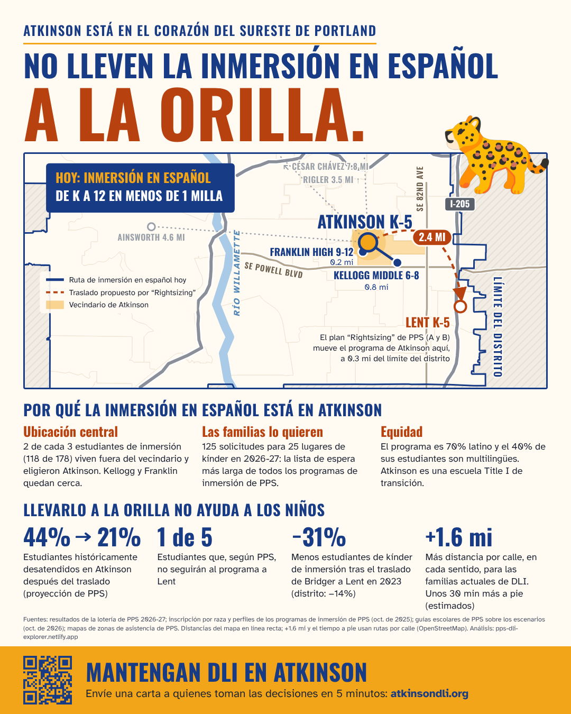
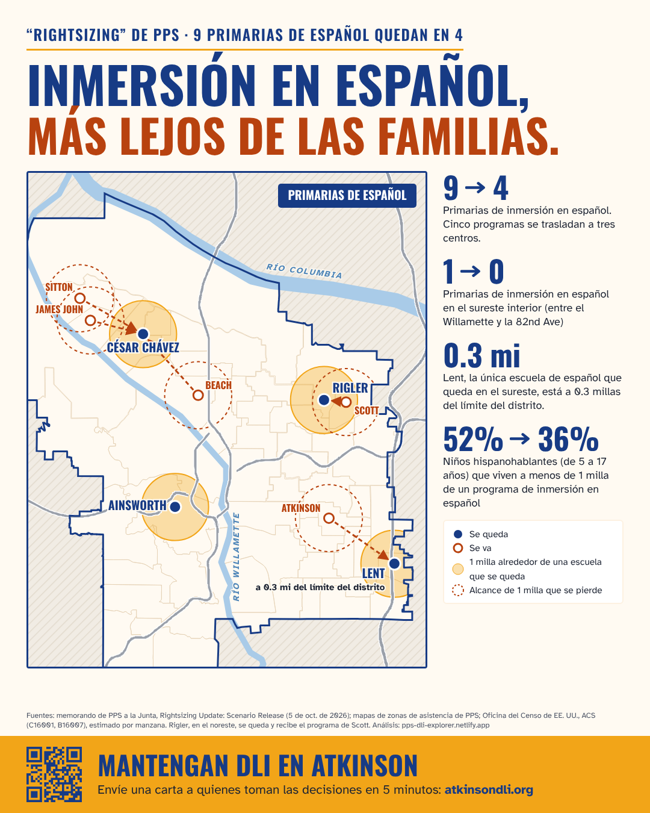

```{r}
options(site.lang = "es")
source("R/site_data.R")
lt <- read_data("lottery_results.csv") |> filter(year == "2026-27", grade == "K", language == "Spanish", school == "Atkinson", !is_total)
gd <- read_data("guide_school.csv") |> filter(school == "Atkinson")
tt <- read.csv("handouts/atkinson_lent_travel_times.csv", comment.char = "#")
trip <- function(mode, col) with(tt[tt$mode == mode & tt$group == "all mapped immersion students", ], get(paste0("to_lent_", col)) - get(paste0("to_atkinson_", col)))
```

Estas dos imágenes son para compartir en redes sociales. Muestran lo que los Escenarios A y B harían con la inmersión en español en la primaria Atkinson y en todo Portland. A diferencia del resto de este sitio, las imágenes toman partido: piden a PPS que mantenga la inmersión en español en Atkinson. Todas sus cifras vienen de los datos de este sitio o de la estimación que se explica abajo.

Para guardar una imagen, ábrala y guárdela. Cada imagen mide 1080 × 1350 píxeles, el tamaño que usa Instagram para publicaciones verticales.

## Atkinson: "No lleven la inmersión en español a la orilla" {#slide-edge}

[{fig-alt="Imagen sobre Atkinson. Título: No lleven la inmersión en español a la orilla. Un mapa del sureste de Portland muestra el programa de inmersión en español de Atkinson, cerca de Franklin High y Kellogg Middle, que se mudaría 2.4 millas al este, a Lent, a 0.3 millas del límite del distrito. Por qué el programa está en Atkinson: 2 de cada 3 estudiantes de inmersión (118 de 178) viven fuera del vecindario; 125 solicitudes para 25 lugares de kínder en 2026-27; el programa es 70% latino y el 40% de sus estudiantes son multilingües. Por qué trasladarlo no ayuda: los estudiantes históricamente desatendidos en Atkinson bajarían del 44% al 21% (proyección de PPS); 1 de cada 5 estudiantes no seguiría al programa, según las cifras de PPS; los estudiantes de kínder de inmersión bajaron un 31% tras el traslado de Bridger a Lent en 2023 (distrito: bajó un 14%); el trayecto sería unas 1.6 millas más largo por calle en cada sentido, y unos 30 minutos más a pie. Pie: Mantengan DLI en Atkinson, atkinsondli.org."}](../handouts/atkinson_dli_slide1_es.png)

**De dónde vienen las cifras**

- **2.4 millas a Lent, a 0.3 millas del límite del distrito:** son distancias en línea recta. Vienen de los mapas de zonas de PPS ([Equidad §4](equity.qmd#sec-burden)).
- **125 solicitudes para 25 lugares de kínder:** la lotería de kínder 2026-27 de Atkinson tuvo `r fmt_n(sum(lt$applications))` solicitudes y `r fmt_n(sum(lt$offered))` ofertas. Su lista de espera, con `r fmt_n(sum(lt$waitlisted))` familias, fue la más larga de todos los programas de inmersión ([Demanda](scorecard.qmd#spanish-waitlists-over-time)). Una familia puede solicitar varias escuelas.
- **70% latino, 40% multilingües:** inscripción de PPS por raza y por programa, octubre de 2025 ([Equidad §3](equity.qmd#sec-who)).
- **44% → 21%:** la propia proyección de PPS del porcentaje de estudiantes de grupos raciales desatendidos en Atkinson: `r fmt_pct(gd$pct_underserved_race[gd$scenario == "sq"])` sin cambios y `r fmt_pct(gd$pct_underserved_race[gd$scenario == "a/b"])` después del traslado ([Cambios por escuela §1](schools.qmd#sec-map)).
- **1 de cada 5 no seguiría al programa:** PPS no da esta cifra. Se deduce de sus propias proyecciones: unos 4 de cada 5 estudiantes del programa de Atkinson llegan a Lent ([Equidad §5](equity.qmd#sec-optout)).
- **−31% frente a −14%:** compara los estudiantes de inmersión en español por grado en Bridger y Lent antes del traslado de 2023. Los compara con los estudiantes de kínder de Lent después. Medido igual, el distrito bajó un 14%. Ambas cifras son estimaciones ([Demanda](scorecard.qmd#a-precedent-bridgers-spanish-program-moved-to-lent-in-2023)).
- **+1.6 millas, unos +30 minutos a pie:** nuestra estimación por calles y aceras para las familias de inmersión de Atkinson de hoy. El trayecto a Lent sería `r sprintf("%.1f", trip("drive", "mi"))` millas más largo en auto y `r round(trip("walk", "min"))` minutos más largo a pie, en cada sentido. Es una estimación, no una distancia medida (vea abajo).

::: {.source}
`r cite("lottery26", "race_program", "guide_demo", "memo", "travel_osm")`
:::

## Todo Portland: "Inmersión en español, más lejos de las familias" {#slide-farther}

[{fig-alt="Imagen sobre todo Portland. Título: Inmersión en español, más lejos de las familias. Un mapa de Portland muestra las nueve primarias de inmersión en español de hoy. Cinco programas se trasladan a tres centros: Sitton, James John y Beach a César Chávez, Scott a Rigler, y Atkinson a Lent. Ainsworth se queda. Cifras: las primarias de inmersión en español pasan de 9 a 4; el sureste interior de Portland, entre el Willamette y la 82nd Avenue, pasa de 1 primaria de inmersión en español a 0; Lent, la única escuela de español que queda en el sureste, está a 0.3 millas del límite del distrito; el porcentaje de niños hispanohablantes de 5 a 17 años que viven a menos de 1 milla de un programa de inmersión en español baja del 52% al 36%. Pie: Mantengan DLI en Atkinson, atkinsondli.org."}](../handouts/atkinson_dli_slide3_es.png)

**De dónde vienen las cifras**

- **De 9 a 4 primarias:** en ambos escenarios, Sitton, James John y Beach se trasladan a César Chávez, Scott a Rigler y Atkinson a Lent. El memorando de PPS sobre los escenarios enumera los traslados ([Demanda](scorecard.qmd#scorecard-every-program-move)).
- **De 1 a 0 en el sureste interior:** Atkinson es la única primaria de inmersión en español entre el río Willamette y la 82nd Avenue. Lent está al este de la 82nd.
- **52% → 36%:** niños hispanohablantes de 5 a 17 años que viven a menos de 1 milla de una primaria de inmersión en español. Usa datos del censo repartidos por manzana ([Demanda](scorecard.qmd#distance-to-the-nearest-site)). [Métodos](methods.qmd) da los rangos del 90% de esta estimación.
- **A 0.3 millas del límite del distrito:** distancia en línea recta en los mapas de zonas de asistencia de PPS ([Equidad §4](equity.qmd#sec-burden)).

::: {.source}
`r cite("memo", "guides", "acs", "blocks")`
:::

## Sobre la estimación del trayecto {#travel-estimate}

Las cifras de distancia por calle y a pie de la imagen sobre Atkinson son una estimación nuestra, no de PPS. Ubicamos a los estudiantes de inmersión en español de Atkinson según la zona donde viven, con el informe de PPS sobre dónde viven los estudiantes. Dentro de cada zona, los repartimos como se reparten los niños de 5 a 17 años entre las secciones censales. Luego pedimos al servicio de rutas de OpenStreetMap el trayecto a Atkinson y a Lent. Los tiempos en auto suponen que no hay tráfico. Los trayectos reales dependen de dónde vive cada familia, del tráfico y de la ruta que tome. Los [datos y el método](https://github.com/jminnier/pps-dli-explorer/blob/main/handouts/atkinson_lent_travel_times.csv) están en GitHub.

::: {.source}
`r cite("by_residence", "travel_osm")`
:::
