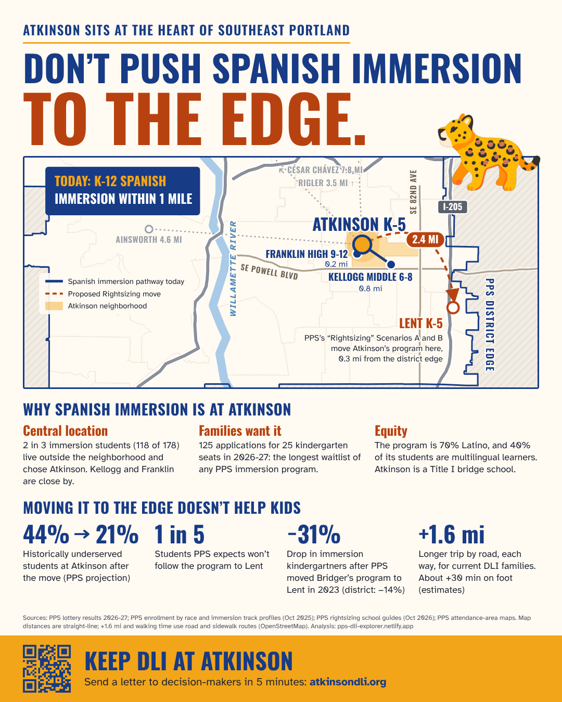
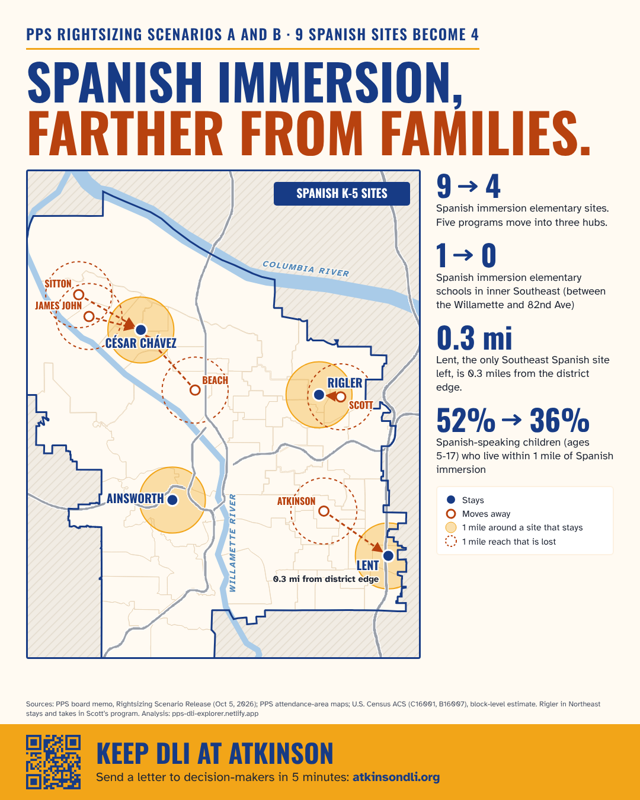

```{r}
source("R/site_data.R")
lt <- read_data("lottery_results.csv") |> filter(year == "2026-27", grade == "K", language == "Spanish", school == "Atkinson", !is_total)
gd <- read_data("guide_school.csv") |> filter(school == "Atkinson")
tt <- read.csv("handouts/atkinson_lent_travel_times.csv", comment.char = "#")
trip <- function(mode, col) with(tt[tt$mode == mode & tt$group == "all mapped immersion students", ], get(paste0("to_lent_", col)) - get(paste0("to_atkinson_", col)))
```

These two slides are for sharing on social media. They show what Scenarios A and B would do to Spanish immersion at Atkinson Elementary and across Portland. Unlike the rest of this site, the slides take a side: they ask PPS to keep Spanish immersion at Atkinson. Every number on them comes from this site's data or from the estimate described below.

To save a slide, open it and save the image. Each slide is 1080 × 1350 pixels, the size Instagram uses for portrait posts.

## Atkinson: "Don't push Spanish immersion to the edge" {#slide-edge}

[{fig-alt="Slide about Atkinson. Title: Don't push Spanish immersion to the edge. A map of Southeast Portland shows Atkinson's Spanish immersion program, near Franklin High and Kellogg Middle, moving 2.4 miles east to Lent, 0.3 miles from the district edge. Why the program is at Atkinson: 2 in 3 immersion students (118 of 178) live outside the neighborhood; 125 applications for 25 kindergarten seats in 2026-27; the program is 70% Latino and 40% multilingual learners. Why moving it doesn't help: historically underserved students at Atkinson fall from 44% to 21% (PPS projection); 1 in 5 students won't follow the program, by PPS's numbers; immersion kindergartners fell 31% after Bridger's program moved to Lent in 2023 (district: down 14%); the trip is about 1.6 miles longer by road each way, and about 30 minutes longer on foot. Footer: Keep DLI at Atkinson, atkinsondli.org."}](handouts/atkinson_dli_slide1.png)

**Where the numbers come from**

- **2.4 miles to Lent, 0.3 miles from the district edge:** straight-line distances on PPS's attendance-area maps ([Equity §4](equity.qmd#sec-burden)).
- **125 applications for 25 kindergarten seats:** Atkinson's 2026-27 kindergarten lottery had `r fmt_n(sum(lt$applications))` applications and `r fmt_n(sum(lt$offered))` offers. Its waitlist, `r fmt_n(sum(lt$waitlisted))` families, was the longest of any immersion program ([Demand](scorecard.qmd#spanish-waitlists-over-time)). One family can apply to several schools.
- **70% Latino, 40% multilingual learners:** PPS's October 2025 enrollment by race and program ([Equity §3](equity.qmd#sec-who)).
- **44% → 21%:** PPS projects Atkinson's share of students from underserved racial groups. It is `r fmt_pct(gd$pct_underserved_race[gd$scenario == "sq"])` with no changes and `r fmt_pct(gd$pct_underserved_race[gd$scenario == "a/b"])` after the move ([School changes §1](schools.qmd#sec-map)).
- **1 in 5 won't follow:** PPS doesn't state this number. Its own projections imply it: about 4 in 5 students in Atkinson's program arrive at Lent ([Equity §5](equity.qmd#sec-optout)).
- **−31% vs. −14%:** Spanish immersion students per grade at Bridger and Lent before the 2023 move, compared with Lent's kindergartners after it. The district fell 14% measured the same way. Both are estimates ([Demand](scorecard.qmd#a-precedent-bridgers-spanish-program-moved-to-lent-in-2023)).
- **+1.6 miles, about +30 minutes on foot:** our road and sidewalk estimate for today's Atkinson immersion families. The trip to Lent would be `r sprintf("%.1f", trip("drive", "mi"))` miles longer by car and `r round(trip("walk", "min"))` minutes longer on foot, each way. This is an estimate, not a measured distance (see below).

::: {.source}
`r cite("lottery26", "race_program", "guide_demo", "memo", "travel_osm")`
:::

## Across Portland: "Spanish immersion, farther from families" {#slide-farther}

[{fig-alt="Slide about all of Portland. Title: Spanish immersion, farther from families. A map of Portland shows the nine Spanish immersion elementary sites today. Five programs move into three hubs: Sitton and James John to César Chávez, Beach to César Chávez, Scott to Rigler, and Atkinson to Lent. Ainsworth stays. Numbers: 9 Spanish immersion elementary sites become 4; inner Southeast Portland, between the Willamette and 82nd Avenue, goes from 1 Spanish immersion elementary school to 0; Lent, the only Southeast Spanish site left, is 0.3 miles from the district edge; the share of Spanish-speaking children ages 5 to 17 who live within 1 mile of Spanish immersion falls from 52% to 36%. Footer: Keep DLI at Atkinson, atkinsondli.org."}](handouts/atkinson_dli_slide3.png)

**Where the numbers come from**

- **9 sites become 4:** in both scenarios, Sitton, James John and Beach move to César Chávez, Scott moves to Rigler, and Atkinson moves to Lent. PPS's scenario release memo lists the moves ([Demand](scorecard.qmd#scorecard-every-program-move)).
- **1 → 0 in inner Southeast:** Atkinson is the only Spanish immersion elementary site between the Willamette River and 82nd Avenue. Lent is east of 82nd.
- **52% → 36%:** Spanish-speaking children ages 5-17 who live within 1 mile of a Spanish immersion elementary site, from census data placed on city blocks ([Demand](scorecard.qmd#distance-to-the-nearest-site)). [Methods](methods.qmd) gives the 90% ranges for this estimate.
- **0.3 miles from the district edge:** straight-line distance on PPS's attendance-area maps ([Equity §4](equity.qmd#sec-burden)).

::: {.source}
`r cite("memo", "guides", "acs", "blocks")`
:::

## About the travel estimate {#travel-estimate}

The road and walking figures on the Atkinson slide are our estimate, not PPS's. We placed Atkinson's Spanish immersion students by the area where they live, from PPS's report on where students live. Within each area, we spread them out the way children ages 5-17 are spread across census tracts. Then we asked OpenStreetMap's routing service for the trip to Atkinson and to Lent. Driving times assume no traffic. Real trips depend on where each family lives, traffic and the route a family takes. The [data and method](https://github.com/jminnier/pps-dli-explorer/blob/main/handouts/atkinson_lent_travel_times.csv) are on GitHub.

::: {.source}
`r cite("by_residence", "travel_osm")`
:::
